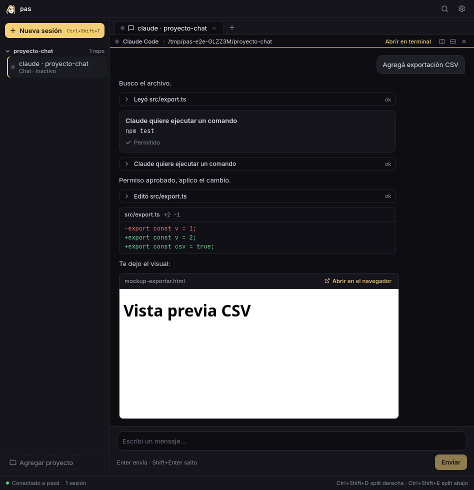
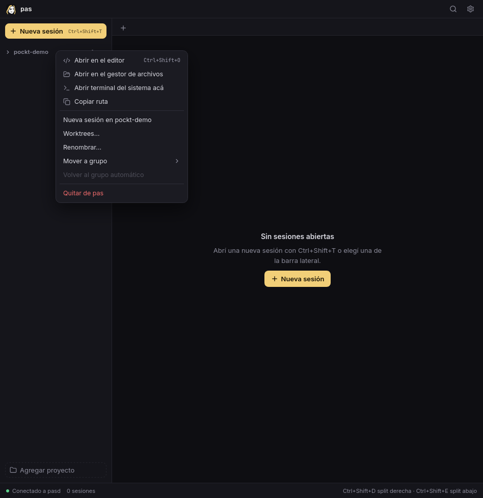
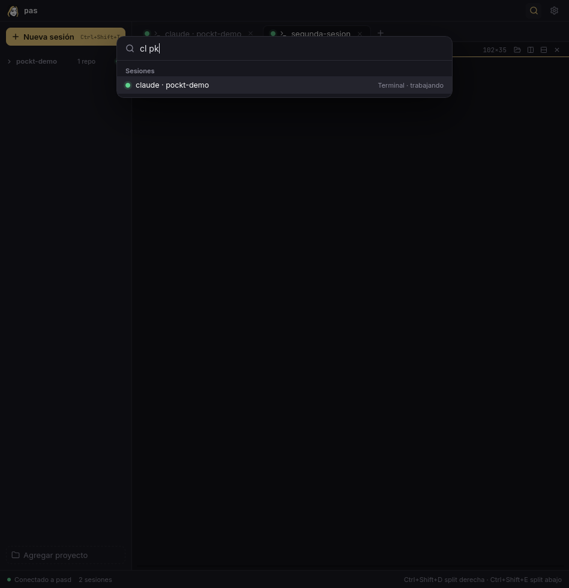

<p align="center">
  <picture>
    <source media="(prefers-color-scheme: dark)" srcset="docs/brand/pas-logo-dark.png">
    
  </picture>
</p>

<p align="center">
  <b>Un multiplexor para agentes de código.</b><br>
  Claude Code, Codex y agy en un solo lugar: varias cuentas, terminal o chat, worktrees y avisos cuando te necesitan.
</p>

<p align="center">
  
  
  
  
</p>

---

<p align="center">
  
</p>

## Qué es

pas te deja trabajar con varios agentes de código a la vez sin perderte. Cada sesión vive en un daemon (`pasd`), así que podés cerrar la ventana y volver: las sesiones siguen corriendo y la interfaz se reconecta sola.

Cada sesión se abre como **terminal** (la TUI del agente, tal cual) o como **chat** (el mismo agente y la misma cuenta, vía [ACP](https://agentclientprotocol.com), con mensajes, herramientas, diffs y permisos con botones). Las dos conviven en pestañas y splits.

## Funciones

- **Terminal o chat por sesión.** Elegís el modo al abrirla. En chat, "Abrir en terminal" sigue la misma conversación de Claude con `claude --resume`.
- **Varias cuentas por agente.** Reusa los directorios que ya tenés (perfiles de Claude de Orca, `~/.claude`, `~/.codex`) y los detecta solo. pas nunca lee credenciales.
- **Estado y avisos.** Punto verde, naranja, gris o rojo por sesión. Cuando un agente espera tu respuesta, te llega un aviso de escritorio con "Abrir". Usa los hooks de cada agente (instalación con respaldo y confirmación) y una heurística de pantalla cuando hace falta.
- **Cuotas.** Barra con el uso de 5 h y 7 días por cuenta, leído de cada agente. Avisa al pasar un umbral (80 % por defecto). Si no hay dato, muestra "sin datos": nunca un número inventado.
- **Worktrees.** Abrí una sesión en una rama y carpeta aparte. Al terminar elegís "Mergear y borrar", "Solo borrar" o "Dejar". Si se perdería trabajo, pas te muestra qué y pide confirmación. Nunca borra en silencio.
- **Proyectos agrupados.** Los repos con el mismo remoto se agrupan solos, y podés armar tus propios grupos.
- **Abrir rápido.** Selector de carpetas, repos sugeridos, "Abrir en el editor" (VS Code u otro), rutas `archivo:línea` clickeables en el chat y la terminal, y una paleta con Ctrl+K.
- **Orquestación por CLI.** Un agente (o vos) maneja a otros con `pas new/send/wait/read`. `send` verifica que el texto llegó al prompt y `wait` sabe cuándo el agente terminó de verdad.

<p align="center">
  
  
</p>

## Orquestar desde la terminal

```sh
pas new --title worker -- agy               # abre agy en una sesión nueva
pas new --worktree --branch pas/csv -- claude  # la misma idea, en su propio worktree
pas send worker "Agregá exportación CSV y corré los tests"
pas wait worker --until idle --timeout 600  # bloquea hasta que termine
pas read worker --lines 40                  # salida reciente, sin códigos ANSI
pas list                                    # sesiones y su estado
pas kill worker
```

`pas` arranca `pasd` solo si no está corriendo. Habla JSON-RPC por un socket Unix en `$XDG_RUNTIME_DIR/pas/pasd.sock`.

## Instalar desde el código

Requisitos: Linux, Rust estable (edición 2024), Node.js 20+, [las dependencias de Tauri 2](https://v2.tauri.app/start/prerequisites/) y `cargo install tauri-cli`.

```sh
git clone https://github.com/Pacotez12/pas
cd pas
cargo build --release -p pasd -p pas-cli     # daemon y CLI
cd crates/pas-gui
npm install
cargo tauri build --no-bundle               # la app de escritorio
```

Para el modo chat, Claude y Codex necesitan sus adaptadores ACP. pas te ofrece instalarlos desde la app (en `~/.local/share/pas/acp`, nunca global). agy ya trae el suyo (`agy acp`).

## Configuración

`~/.config/pas/config.toml` (todo es opcional):

```toml
notifications = true        # avisos de escritorio
quota_warn_percent = 80     # umbral del aviso de cuota
editor = "code"             # editor para "Abrir en el editor"
worktrees_dir = "~/.local/share/pas/worktrees"
```

Los datos viven en `~/.local/share/pas/` (base SQLite, historial de chats, worktrees y adaptadores).

## Cómo está hecho

| Crate | Qué hace |
|---|---|
| `pas-core` | Protocolo JSON-RPC, cliente y arranque automático del daemon |
| `pasd` | Daemon: sesiones con PTY, chat ACP, cuentas, hooks, cuotas, worktrees |
| `pas-cli` | La CLI `pas` |
| `pas-gui` | App de escritorio: Tauri 2, React, xterm.js |
| `tools/fake-agent`, `tools/fake-acp-agent` | Agentes falsos para los tests |

Los tests nunca usan cuentas reales ni gastan cuota: corren contra agentes falsos, repos temporales y un HOME aislado.

```sh
cargo test --workspace
cd crates/pas-gui && npm test && npm run e2e   # e2e con tauri-driver
```

## Estado

pas está en desarrollo activo y por ahora solo funciona en Linux. La interfaz está en español. Lo próximo es una vista "Todos" con todas las sesiones como tarjetas.

## Licencia

El código se publica bajo MIT o Apache-2.0, a tu elección. Los archivos de licencia se suman en breve. El logo y el personaje no entran en esa licencia: son de su autor y no se pueden reutilizar sin permiso.
